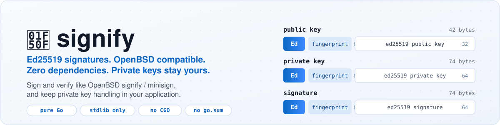
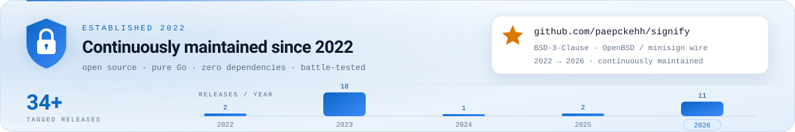
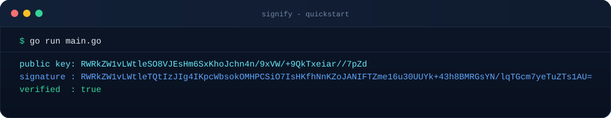
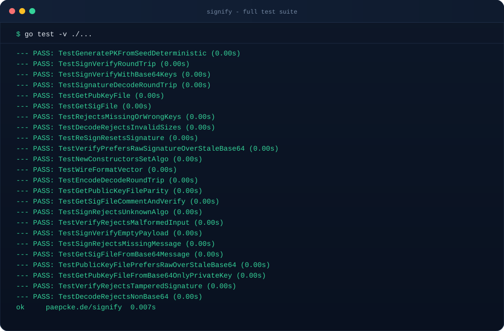

<div align="center">

<picture>
  <source media="(prefers-color-scheme: dark)" srcset="docs/hero-dark.svg">
  <source media="(prefers-color-scheme: light)" srcset="docs/hero-light.svg">
  
</picture>

# 🔏 signify

**Ed25519 signatures. OpenBSD compatible. Zero dependencies.**

Create and verify OpenBSD [signify](https://man.openbsd.org/signify) /
[minisign](https://jedisct1.github.io/minisign/) compatible Ed25519 signatures
from pure Go, while private key handling stays exactly where it belongs: in
*your* application.

[](https://pkg.go.dev/paepcke.de/signify)
[](https://goreportcard.com/report/paepcke.de/signify)
[](https://github.com/paepckehh/signify/actions/workflows/golang.yml)
[](https://github.com/paepckehh/signify/blob/main/go.mod)
[](https://github.com/paepckehh/signify/blob/main/LICENSE)
[](https://github.com/paepckehh/signify/releases/latest)

```shell
go get paepcke.de/signify
```

<picture>
  <source media="(prefers-color-scheme: dark)" srcset="docs/established-dark.svg">
  <source media="(prefers-color-scheme: light)" srcset="docs/established-light.svg">
  
</picture>

</div>

---

## 💡 Why

OpenBSD `signify` protects private keys with bcrypt/pbkdf passphrases. That is
great for a CLI and wrong for an HSM, a smartcard, a cloud KMS, or an app that
already owns its key lifecycle.

`paepcke.de/signify` implements the **wire format and the Ed25519 operations**,
and deliberately stops there. You decide how the seed becomes a key, where it
lives, and how it is unlocked.

**No passphrase prompts. No key files written. No hidden state.** Just the
primitives, in one tiny package.

- 🪶 **100% pure Go, stdlib only** — no external modules, no `go.sum`, no CGO
- 🔐 **Secrets stay yours** — no built-in KDF, no prompts, no file or network I/O
- 🧩 **Tiny, flat API** — nine types (four high-level, three raw wire structs,
  two array aliases) and a handful of methods, all in [`api.go`](api.go)
- 🔁 **Dual representation** — every key, signature, and message has a `Raw`
  binary form and a base64 wire form
- 🧾 **OpenBSD file framing** — `untrusted comment:` lines via `GetPubKeyFile`
  and `GetSigFile`
- 🌱 **Deterministic key generation** — reproduce keys from a 40-byte seed token
  via `GeneratePKFromSeed`
- ✅ **Signed, then self-verified** — every `Sign` verifies its own output before
  returning
- 🛡 **Strict by default** — wrong sizes, unknown algorithms, missing keys, and
  fingerprint mismatches are errors, never silent rejections
- 📦 **Library-first** — no CLI, no globals, no `init()` magic

## 🚀 Install

**Go** (any platform with a Go toolchain):

```shell
go get paepcke.de/signify
```

Requires Go 1.27.2 or newer (`go.mod` declares `go 1.27.2`).

**Browse the API locally:**

```shell
go doc paepcke.de/signify
```

## 🎬 Showtime

The whole loop: seed in, key out, sign, verify.

```go
package main

import (
	"fmt"
	"log"

	"paepcke.de/signify"
)

func main() {
	// 32 bytes of seed + 8 bytes of fingerprint, e.g. from your KMS or HSM.
	var token [signify.SeedTokenSize]byte
	copy(token[:], "0123456789abcdef0123456789abcdef")
	copy(token[signify.SeedSize:], "demo-key")

	pk := signify.GeneratePKFromSeed(token)
	pub := pk.GetPublicKey()

	msg := &signify.Message{Raw: []byte("hello, world")}
	if err := msg.Sign(pk); err != nil {
		log.Fatal(err)
	}
	ok, err := msg.Verify(pub)
	if err != nil || !ok {
		log.Fatalf("verification failed: ok=%v err=%v", ok, err)
	}

	if err := pub.Encode(); err != nil {
		log.Fatal(err)
	}
	fmt.Println("public key:", pub.Base64)
	fmt.Println("signature :", msg.Signature.Base64)
	fmt.Println("verified  :", ok)
}
```

```text
public key: RWRkZW1vLWtleSO8VJEsHm6SxKhoJchn4n/9xVW/+9QkTxeiar//7pZd
signature : RWRkZW1vLWtleTQtIzJIg4IKpcWbsokOMHPCSiO7IsHKfhNnKZoJANIFTZme16u30UUYk+43h8BMRGsYN/lqTGcm7yeTuZTs1AU=
verified  : true
```

The key ID is literally `demo-key` here because it was copied from the seed
token into the fingerprint field. In production, use a random or KMS-managed
fingerprint.

### 📸 Real output

<p align="center">
  
</p>

<p align="center"><sub><b>Quickstart, real terminal output</b> - seed in, key out, signature self-verified.</sub></p>

### Verify data you already have

`Verify` lazily decodes the message, the signature, and the public key from
their base64 forms. The signature fingerprint must match the public key
fingerprint, and then Ed25519 does the rest. `Raw` fields take precedence; a
`Base64` field is decoded only when its `Raw` form is still empty.

```go
msg := &signify.Message{
	Raw:       payload,
	Signature: signify.Signature{Base64: signatureLine},
}

ok, err := msg.Verify(signify.PublicKey{Base64: publicKeyLine})
```

### Produce OpenBSD-style files

```go
sigFile, err := msg.GetSigFile(pk)
pubFile, err := pk.GetPubKeyFile("release signing key")
```

`GetSigFile` signs the message (again) and returns an `untrusted comment:` line
using `msg.UntrustedComment`, followed by the base64 signature. A single space
is inserted after the colon, and comments that already start with one are left
unchanged, so OpenBSD's exact `untrusted comment: ` prefix is always present.
`GetPubKeyFile` accepts a comment and returns the `signify public key` header
followed by the base64 public key. Both keys expose it:

```go
pub := pk.GetPublicKey()
pubFile, err := pub.GetPubKeyFile("release signing key")
```

## 🧩 API at a glance

Full reference: [pkg.go.dev/paepcke.de/signify](https://pkg.go.dev/paepcke.de/signify).

### Constants

| Constant | Value | Meaning |
| :--- | ---: | :--- |
| `SeedSize` | 32 | Ed25519 seed length |
| `SeedTokenSize` | 40 | `SeedSize` + `FingerPrintSize` |
| `FingerPrintSize` | 8 | key ID embedded in every wire blob |
| `KeyAlgoSize` | 2 | algorithm tag length (`"Ed"`) |
| `PrivateKeySize` | 64 | Ed25519 private key length |
| `PublicKeySize` | 32 | Ed25519 public key length |
| `SignatureSize` | 64 | Ed25519 signature length |
| `PrivatePublicKeyOffset` | 32 | offset of the public key inside the private key |

### Types

| Type | Purpose |
| :--- | :--- |
| `Signature` | base64 + raw Ed25519 signature (`RawSignature`) |
| `PublicKey` | base64 + raw public key (`RawPublicKey`) |
| `PrivateKey` | base64 + raw private key (`RawPrivateKey`) |
| `Message` | payload, untrusted comment, signature, public key |
| `KeyAlgo` / `FingerPrint` | wire tag and key ID array types |
| `RawSignature` / `RawPublicKey` / `RawPrivateKey` | fixed-size wire structs |

### Functions and methods

| Symbol | Purpose |
| :--- | :--- |
| `NewSignature`, `NewPublicKey`, `NewPrivateKey`, `NewMessage` | constructors pre-set to the Ed25519 algorithm tag |
| `GeneratePKFromSeed` | deterministic key from a `SeedTokenSize` seed token |
| `PrivateKey.GetPublicKey` | derive the matching public key |
| `PrivateKey.GetPubKeyFile` / `PublicKey.GetPubKeyFile` | OpenBSD public key file framing |
| `Message.Sign` | sign raw or base64 message data |
| `Message.Verify` | verify with fingerprint and Ed25519 checks |
| `Message.GetSigFile` | sign and frame an OpenBSD signature file |
| `Encode` / `Decode` | move between `Raw` and base64 wire forms on all wire types |

Encoding and decoding works on `PublicKey`, `PrivateKey`, `Signature`, and
`Message`:

```go
if err := pk.Encode(); err != nil { /* Raw  -> Base64 */ }
if err := pk.Decode(); err != nil { /* Base64 -> Raw, size checked */ }
```

`Message.Encode` rejects a nil or zero-length payload rather than producing an
empty wire string that `Decode` would refuse. Sign and verify empty payloads by
setting `Message.Raw` directly.

`Sign` replaces any previous signature with a fresh one, stores the derived
public key in `msg.PublicKey`, and leaves the encoded signature in
`msg.Signature.Base64`. `PublicKey.GetPubKeyFile` always re-encodes `Raw`, so a
stale `Base64` field cannot leak into the file; a public key supplied only as
base64 is decoded and size-checked first. Both public key file paths reject an
unknown algorithm tag instead of writing a file that could never verify.

## 🔍 Wire format

```text
public key : "Ed" | fingerprint[8] | ed25519 public key[32]   = 42 bytes
private key: "Ed" | fingerprint[8] | ed25519 private key[64]  = 74 bytes
signature  : "Ed" | fingerprint[8] | ed25519 signature[64]    = 74 bytes
```

All multi-byte fields are written big-endian (`encoding/binary`), and the
textual form is standard base64 (`base64.StdEncoding`). Decoders reject any blob
whose length does not match the exact wire size for its type.

Files use the OpenBSD convention, every line `\n`-terminated:

```text
untrusted comment: signify public key <your comment>
<base64 public key>
```

```text
untrusted comment: <your comment>
<base64 signature>
```

## 🛡 Security model

- **You own the secret.** This library never derives an encryption key from a
  passphrase, never writes keys to disk, and never prompts. HSM, smartcard, KDF,
  sealing, and rotation are the caller's job.
- **A key is only as good as its seed.** `GeneratePKFromSeed` is deterministic
  on purpose; use it only when reproducibility is the requirement.
- **Never log `Raw` key material.** `Base64` contains the full secret for a
  private key.
- **Verification is strict.** Wrong sizes, unknown algorithms, missing keys, and
  fingerprint mismatches are errors, never silent rejections.
- **No external dependencies** means a smaller supply chain, not a weaker
  algorithm: signing and verification use `crypto/ed25519` from the standard
  library.

`GeneratePKFromSeed` performs an internal sign/verify self-check and **panics**
if it fails. That is intentional and unrecoverable: a broken Ed25519
implementation must not hand out keys.

Report vulnerabilities to `alert.git (/AT/) paepcke.de` — see
[SECURITY.md](SECURITY.md).

## 🤝 Compatibility

| Surface | Status |
| :--- | :--- |
| OpenBSD `signify` Ed25519 public keys, signatures, and `untrusted comment:` framing | ✅ supported |
| `minisign` Ed25519 public key and signature wire layout (`"Ed"` tag + 8-byte key ID) | ✅ supported |
| `minisign` prehashed signatures, trusted comments, global signatures | ❌ not implemented |
| bcrypt/pbkdf-encrypted private keys | ❌ intentionally out of scope |

The last point is the reason this fork exists. If you need the standard
passphrase-protected private key format, use OpenBSD `signify` directly.

## ⚛️ Post-quantum & SPHINCS+

`signify` is deliberately classical: Ed25519 today. The migration question is
still real. NIST now has a final stateless hash-based signature standard, and
EdDSA is on the retirement path for long-lived systems.

### SLH-DSA is standardized SPHINCS+

**FIPS 205, Stateless Hash-Based Digital Signature Standard (SLH-DSA)**, was
published on **13 August 2024**, together with ML-KEM (FIPS 203) and ML-DSA
(FIPS 204). SLH-DSA is the standardized form of **SPHINCS+**. It is *stateless*
(no one-time-key bookkeeping, unlike LMS/XMSS) and rests only on hash-function
assumptions, making it the conservative hedge against a future lattice break.

The price is signature size and CPU time:

| Parameter set (SHA-2 or SHAKE) | Category | Public key | Private key | Signature |
| :--- | ---: | ---: | ---: | ---: |
| SLH-DSA-128s | 1 | 32 B | 64 B | 7,856 B |
| SLH-DSA-128f | 1 | 32 B | 64 B | 17,088 B |
| SLH-DSA-192s | 3 | 48 B | 96 B | 16,224 B |
| SLH-DSA-192f | 3 | 48 B | 96 B | 35,664 B |
| SLH-DSA-256s | 5 | 64 B | 128 B | 29,792 B |
| SLH-DSA-256f | 5 | 64 B | 128 B | 49,856 B |

`128s`/`192s`/`256s` favor small signatures; `f` variants favor signing speed.
For scale: a signify signature blob is 74 bytes, so a PQ mode would be a new
container, not a new tag on the existing format. FIPS 205 has had no errata or
revision as of October 2026; draft SP 800-230 is the only active SLH-DSA
extension, proposing six `-24` sets at 3,856 / 7,752 / 14,944 bytes for levels
1/3/5.

### 2024–2026 decisions that matter

| Date | Document or decision | Why it matters |
| :--- | :--- | :--- |
| 2024-08-13 | [FIPS 205](https://csrc.nist.gov/pubs/fips/205/final) final | SPHINCS+ becomes SLH-DSA, a NIST signature standard |
| 2024-11-12 | [NIST IR 8547](https://csrc.nist.gov/pubs/ir/8547/ipd) initial public draft | Proposes deprecating 112-bit quantum-vulnerable public-key algorithms after 2030 and disallowing all of them, including EdDSA, after 2035. Still a draft. |
| 2025-03-11 | [NIST IR 8545](https://csrc.nist.gov/pubs/ir/8545/final) final | HQC selected as the second PQC KEM; no signature impact |
| 2026-04-13 | [SP 800-230](https://csrc.nist.gov/pubs/sp/800/230/ipd) initial public draft | Six extra SLH-DSA `-24` sets for firmware, software, and certificates: at most 2^24 signatures per key, with roughly half-size signatures. Comments closed 2026-06-12; not final. |
| 2026-05-14 | [NIST IR 8610](https://csrc.nist.gov/pubs/ir/8610/final) final / [Round 3](https://csrc.nist.gov/projects/pqc-dig-sig/round-3-additional-signatures) | Nine additional signature candidates advanced; HAWK withdrew in October 2026, leaving eight. Evaluation is expected to take about two years. |
| 2026-06-22 | [Executive Order 14412](https://www.federalregister.gov/documents/2026/06/25/2026-12909/securing-the-nation-against-advanced-cryptographic-attacks) | Federal HVAs and high-impact systems (excluding NSS): PQC key establishment by 2030-12-31, PQC signatures by 2031-12-31 |
| 2026-06-24 | [OMB M-26-15](https://www.whitehouse.gov/wp-content/uploads/2026/06/M-26-15-Execution-of-the-Migration-to-Post-Quantum-Cryptography.pdf) | Implements EO 14412; agency migration plans due around 2026-10-22, full migration by 2035 |

NIST IR 8547 has **not** been finalized as of October 2026; the 2030/2035
dates are proposed, not yet binding. FN-DSA (Falcon, FIPS 206) is still in
development, and HQC's standard is expected around 2027.

### The fine print

- **Hybrids are transitional.** IR 8547 permits PQ/classical hybrids during the
  transition but does not settle whether the classical half may remain after
  2035.
- **CNSA 2.0 takes a different path.** NSA's suite (updated May 2025)
  [explicitly excludes SLH-DSA](https://media.defense.gov/2022/Sep/07/2003071836/-1/-1/0/CSI_CNSA_2.0__FAQ_v2.2.PDF)
  for National Security Systems and approves ML-DSA-87 plus LMS/XMSS for
  signatures. Software and firmware signing must exclusively use CNSA 2.0 by
  2030.
- **The additional-signature process is not a SPHINCS+ replacement.** Round 3
  candidates (FAEST, MAYO, MQOM, QR-UOV, SDitH, SNOVA, SQIsign, UOV) explore
  other tradeoffs; FIPS 205 remains the hash-based standard.

### What this means for signify

- **No change today.** Ed25519 remains correct for the wire formats implemented
  here.
- **Plan for long-lived signatures.** If signatures must outlive the 2030–2035
  window, design a PQ or hybrid envelope in the calling application.
- **No stdlib-only SPHINCS+ yet.** Go 1.27 ships [`crypto/mlkem`](https://pkg.go.dev/crypto/mlkem)
  (FIPS 203) and [`crypto/mldsa`](https://pkg.go.dev/crypto/mldsa) (FIPS 204),
  but there is no `crypto/slhdsa`. Adding SLH-DSA here would require a
  third-party module, which would break the zero-dependency invariant. This
  project tracks the standard instead of pretending to implement it.

### Primary sources

- [FIPS 205: Stateless Hash-Based Digital Signature Standard](https://csrc.nist.gov/pubs/fips/205/final) ([PDF](https://nvlpubs.nist.gov/nistpubs/FIPS/NIST.FIPS.205.pdf))
- [FIPS 203: ML-KEM](https://csrc.nist.gov/pubs/fips/203/final) and [FIPS 204: ML-DSA](https://csrc.nist.gov/pubs/fips/204/final)
- [NIST IR 8547: Transition to Post-Quantum Cryptography Standards (draft)](https://csrc.nist.gov/pubs/ir/8547/ipd)
- [NIST SP 800-230: Additional SLH-DSA Parameter Sets (draft)](https://csrc.nist.gov/pubs/sp/800/230/ipd)
- [NIST IR 8610: Additional Digital Signature Schemes, Round 2 report](https://csrc.nist.gov/pubs/ir/8610/final)
- [NIST IR 8545: HQC fourth-round selection report](https://csrc.nist.gov/pubs/ir/8545/final)
- [Executive Order 14412 (Federal Register)](https://www.federalregister.gov/documents/2026/06/25/2026-12909/securing-the-nation-against-advanced-cryptographic-attacks)
- [OMB M-26-15: Execution of the Migration to Post-Quantum Cryptography](https://www.whitehouse.gov/wp-content/uploads/2026/06/M-26-15-Execution-of-the-Migration-to-Post-Quantum-Cryptography.pdf)
- [NSA CNSA 2.0 algorithms](https://media.defense.gov/2025/May/30/2003728741/-1/-1/0/CSA_CNSA_2.0_ALGORITHMS.PDF) and [FAQ v2.2](https://media.defense.gov/2022/Sep/07/2003071836/-1/-1/0/CSI_CNSA_2.0__FAQ_v2.2.PDF)
- [NIST FIPS 206 / FN-DSA presentation](https://csrc.nist.gov/presentations/2025/fips-206-fn-dsa-falcon)

## 🧪 Development

```shell
make            # go build
make test       # go test ./...
make check      # gofmt -w -s . && go vet ./...
```

Or directly:

```shell
gofmt -w -s .
go build ./...
go vet ./...
go test ./...
go test -cover ./...
```

The test suite is stdlib-only and table-driven where it helps, covering
deterministic key generation, constructor defaults, sign/verify round trips,
base64 wire forms, a pinned wire-format vector, file framing and comment
handling, re-signing, malformed input, tamper rejection, and invalid sizes.

<p align="center">
  
</p>

<p align="center"><sub><b>Full suite, real terminal output</b> - 24 tests across signing, verification, and every wire form.</sub></p>

`make deps` is destructive: it deletes `go.mod` and re-initializes the module.
Do not run it casually.

## 📚 Docs & project

- API reference: [pkg.go.dev/paepcke.de/signify](https://pkg.go.dev/paepcke.de/signify)
- Source: [github.com/paepckehh/signify](https://github.com/paepckehh/signify)
- Releases: [github.com/paepckehh/signify/releases](https://github.com/paepckehh/signify/releases)
- Hero artwork: [dark](docs/hero-dark.svg) / [light](docs/hero-light.svg) —
  dependency-free SVG, theme-aware `<picture>`
- Established banner: [dark](docs/established-dark.svg) /
  [light](docs/established-light.svg) — 2022 to today, 34+ tagged releases,
  release-per-year chart (theme-aware `<picture>`)
- Screenshots: [quickstart](docs/screenshot-demo.svg) /
  [test suite](docs/screenshot-tests.svg) — rendered from real captured ANSI
  output with [docs/render_ansi_svg.py](docs/render_ansi_svg.py)
- History: a minimal fork of [`github.com/ebfe/signify`](https://github.com/ebfe/signify)

## 🤝 Contributing

Yes, please! Issues and PRs are welcome — see [CONTRIBUTING.md](CONTRIBUTING.md).

```shell
gofmt -w -s .
go build ./...
go vet ./...
go test ./...
```

## 🛡 License

[BSD 3-Clause License](LICENSE) — see [LICENSE](LICENSE) for details.

## 📃 Citation

```bibtex
@misc{signify,
  author = {Michael Paepcke},
  title = {signify: pure-Go OpenBSD signify / minisign compatible Ed25519 signatures},
  year = {2022},
  publisher = {GitHub},
  journal = {GitHub repository},
  howpublished = {\url{https://paepcke.de/signify}}
}
```
